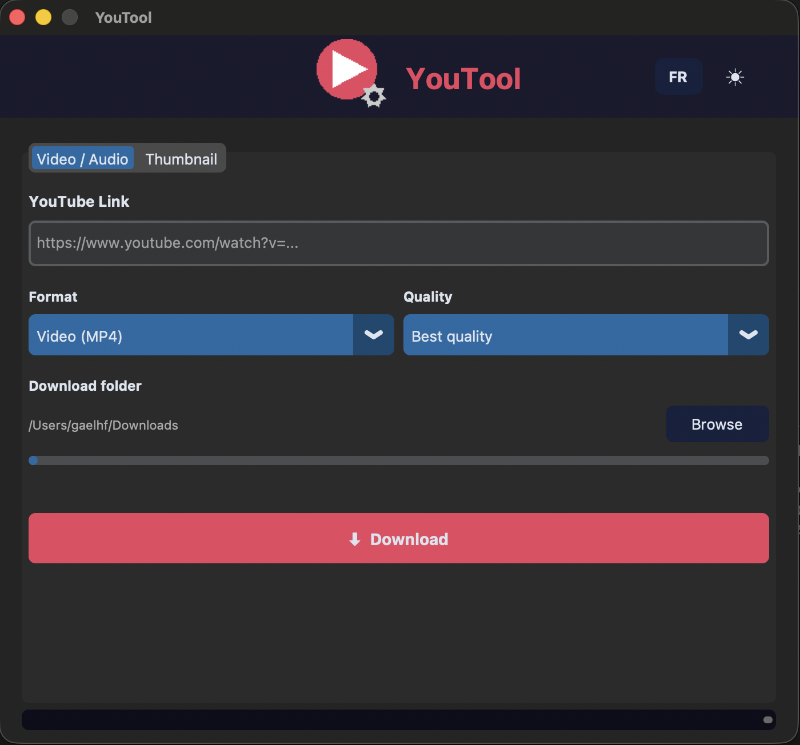

<div align="center">


# YouTool

**A simple desktop app to download YouTube videos, audio and thumbnails.**

[](https://github.com/GaelHF/YouTool/releases/latest)




</div>

## Features

- **Video download (MP4)**: best quality, 1080p, 720p, 480p or 360p
- **Audio download (MP3)**
- **Thumbnail download**, with a preview before saving
- Choice of download folder
- Progress bar with download speed
- Dark and light themes
- French and English interface

## Download

Ready-to-use builds for **Windows** (`.exe`) and **macOS** (`.dmg`) are on the
[**Releases page**](https://github.com/GaelHF/YouTool/releases/latest).

ffmpeg is already included. You don't need to install anything else.

## Run from source

Requirements: Python 3.10 or newer and [ffmpeg](https://ffmpeg.org/download.html).

```bash
git clone https://github.com/GaelHF/YouTool.git
cd YouTool
pip install -r requirements.txt
python app.py
```

YouTool looks for ffmpeg in a `ffmpeg/` folder next to `app.py`, then in your `PATH`.
On Windows you can install it with `winget install ffmpeg`. On macOS, use `brew install ffmpeg`.

## Build

Put `ffmpeg` and `ffprobe` (`ffmpeg.exe` and `ffprobe.exe` on Windows) in a `ffmpeg/` folder at the root of the project, then run:

```bash
pyinstaller YouTool.spec --noconfirm
```

The app is created in `dist/`. PyInstaller can't cross-compile, so build on Windows to get the `.exe` and on macOS to get the `.app`.

> On macOS, use a **static** ffmpeg build. The Homebrew version depends on Homebrew libraries and won't work on other Macs.

## Built with

- [yt-dlp](https://github.com/yt-dlp/yt-dlp)
- [CustomTkinter](https://github.com/TomSchimansky/CustomTkinter)
- [Pillow](https://python-pillow.org/)
- [FFmpeg](https://ffmpeg.org/)

## Disclaimer

YouTool is for personal use only. Respect YouTube's Terms of Service and the rights of content creators. Only download content you are allowed to download.

## License

This project is licensed under the [MIT License](LICENSE).
